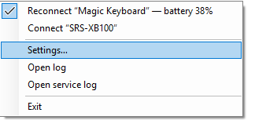
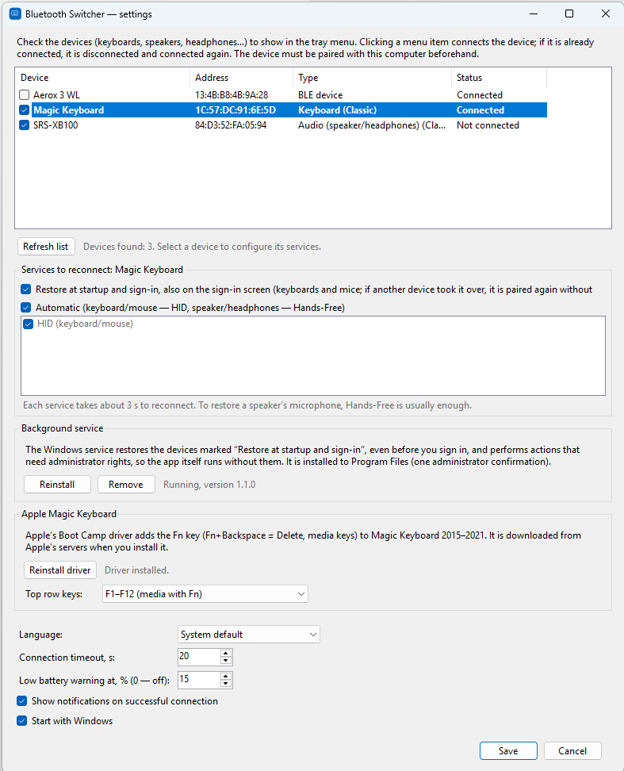

# MagicSwitcher

**Apple Magic Keyboard on Windows, done right.** A small tray app for people who share one Magic Keyboard between a
Windows PC and a Mac, an iPad, a phone or another PC:

- **pulls the keyboard to this PC in one click** — no need to turn off Bluetooth on the other device;
- **makes it type on the Windows sign-in screen**, even right after another device used it: Magic Keyboard keeps the
  pairing key of only one host, and the optional background service pairs it again without the Windows dialog;
- **installs Apple's keyboard driver** for the Fn key (Fn+Backspace = Delete, media keys) and lets you choose whether
  the top row sends F1–F12 or media keys by default;
- **shows the battery level** of the keyboard in the tray and warns when it runs low.

It is also a **one-click reconnector for any other Bluetooth device** paired with Windows:

- **speakers and headphones**: disconnect and connect again in one click, e.g. when a speaker “forgets” its microphone
  (Hands-Free) — no more Settings → Bluetooth → Disconnect → Connect;
- **other multi-host keyboards and mice** (Logitech, Keychron, Microsoft…): pull them over from another computer;
- **battery level** of headsets, speakers and BLE devices that report it;
- **Restart Windows audio** (tray menu → Troubleshooting): when sound or the microphone stops working everywhere and otherwise only
  a reboot would help.

Tested with Apple Magic Keyboard A2450 (2021); the Fn driver supports Magic Keyboard 2015–2021.

<p align="center">
  
</p>

<p align="center">
  
</p>

## Download

Get the latest `MagicSwitcher-<version>-win-x64.zip` from the
[Releases](../../releases) page, unzip it and run `MagicSwitcher.exe` (no installation and no .NET runtime
needed). The app is not code-signed, so Windows SmartScreen may warn on the first start: **More info → Run anyway**.

## Quick start with Magic Keyboard

1. Pair the keyboard with Windows once (Settings → Bluetooth & devices → Add device; turn the keyboard off and on
   to make it visible).
2. Start `MagicSwitcher.exe`, open **Settings** from the tray icon and choose your keyboard on the **Keyboard** tab.
3. Keep **Restore at startup and sign-in** checked and click **Install service** (one administrator confirmation).
4. Optionally, in **Apple Magic Keyboard**, click **Install driver**, choose the **top row** behavior and remap keys.
5. Click **Save**.

From then on:

- to use the keyboard here after another device, click **Connect “Magic Keyboard”** in the tray menu (or double-click
  the icon) and turn the keyboard off and on (if it was only asleep, pressing a key is enough);
- after a restart, or when the PC is locked, just turn the keyboard off and on (or press a key): it types within
  about a minute, no dialog, even before you sign in.

## Sign-in screen and switching back: the background service

Some multi-host keyboards — Apple Magic Keyboard in particular — keep the pairing key of only one host. After the
keyboard was used with a phone or another computer, it rejects this PC until it is paired again, and Windows asks
for confirmation in a dialog. Before you sign in there is nobody to answer it, so the keyboard simply does not type.

The optional Windows service fixes that. Install it in **Settings → Background service → Install service**
(one administrator confirmation) and check **Restore at startup and sign-in** for the keyboard. The service:

- reacts to events: Windows startup, sign-in, unlock, wake from sleep, the display turning on, and **Connect** in the tray;
- first gives the keyboard time to reconnect by itself (45 seconds after startup or wake: knocking earlier breaks a
  connection that is coming up and makes Windows drop the key), then “knocks” every 20–30 seconds for up to 10 minutes;
- if Windows still has the key, first pages the keyboard without touching the pairing (an uncached SDP query). Only if it
  answers but still does not connect — it is awake and rejects the key, e.g. after a phone used it — the service
  reinstalls the HID service. Reinstalling HID while the keyboard sleeps would make Windows remove a good pairing
  (when the first HID connection fails, Windows deletes the link key); a sleeping keyboard reconnects by itself when you
  press a key. If the key is gone (or Windows forgot the device),
  pairs again with bonding (`BluetoothAuthenticateDeviceEx`), answers the pairing request itself
  (`BluetoothRegisterForAuthenticationEx`) so no dialog appears, and enables the HID service;
- keeps watching until the keyboard has worked for a minute without interruption: right after startup it may connect
  and drop again (Windows then removes the pairing), and the service pairs it again right away;
- never knocks outside these events: when you hand the keyboard to a phone on purpose, it is left alone. Every event,
  the keyboard state and the service's decision are written to the service log.

After another host used the keyboard, turn the keyboard off and on (or press a key) on the sign-in screen: it only
listens for a new host for a short while after it wakes up. It types within about a minute.

> 🔒 Automatic confirmation skips the pairing code check. The service confirms only devices you selected and only while
> it is restoring them after one of the events above; at any other time Windows asks as usual.

The service also performs the actions that need administrator rights for the tray app (reinstalling device services,
the Apple keyboard driver), so the app itself runs without them. It is installed to
`%ProgramFiles%\MagicSwitcher` and runs as LocalSystem: a service must not start an executable that a normal user
could replace. After updating the app, use **Update service** in the settings. Tested with Apple Magic Keyboard (A2450).

## Fn key and top row

On its own, Windows ignores the Fn key of Apple keyboards, so Fn+Backspace (Delete) and the media keys on the
top row do not work. Apple's Boot Camp keyboard driver fixes that, and the app can install it for you:
**Settings → Apple Magic Keyboard → Install driver**. The section is shown only when a supported Magic Keyboard
(2015–2021) is paired with the computer or the driver is already installed.

- The driver is **not shipped with the app**: it is Apple's proprietary software. The app downloads the official
  Boot Camp 6.1.14 update from Apple's servers, verifies its SHA-256, extracts the keyboard driver
  (`AppleKeyboardMagic2`, version 6.1.8086.4, which knows the 2021 keyboards, e.g. A2450) and installs it with
  `pnputil`. An internet connection and administrator rights are required. Apple's Boot Camp license terms apply.
- **Top row keys** (“Fn Lock”): F-keys or media keys without Fn. **Fn+Esc** switches at any time, and the tray shows
  which mode is on. The driver itself always stays in its default mode (media keys; F-keys with Fn); MagicSwitcher
  swaps the keys of the Apple keyboard in your session: the media keys become F7–F12 (the keyboard's consumer-control
  HID report arrives just before the media key and tells which keyboard it came from), and the Spotlight and dictation
  keys, which the driver sends as Win+S and Win+C, become F4 and F5. F3 and F6 are F-keys in both modes.
  **F1 and F2 always need Fn**: the driver keeps the brightness keys to itself, and Windows never sees them.
- Why not the driver's own setting (`OSXFnBehavior`)? Versions up to 1.3 switched it, but the driver reads it only when
  the keyboard starts, so every change meant restarting the keyboard (which could leave it without input after sleep),
  the driver's installer resets it whenever Windows installs the keyboard again, and in its F-keys mode the driver can
  lose the release of Delete pressed as **Fn+Backspace** — after Ctrl+Option+Fn+Backspace no keyboard types on the
  sign-in screen. On the sign-in and lock screens the top row sends media keys.
- The lock key (top right on 2021 models) is not handled by the driver.
- To remove the driver: Device Manager → the keyboard (“Apple Keyboard”) → Uninstall device → check
  “Attempt to remove the driver for this device”, then reconnect the keyboard.

## Remapping keys of the Apple keyboard only

**Settings → Apple Magic Keyboard → Remap keys…** changes what Caps Lock, Shift, Control, Option and Command send
(e.g. right Command → Delete, Caps Lock → Ctrl) on Apple keyboards only — other keyboards are not affected, unlike a
`Scancode Map` in the registry, which changes all keyboards. Works over Bluetooth and USB.

How: a low-level keyboard hook can replace keys but does not know which keyboard sent them; raw input knows the device
but arrives about a millisecond later, and not at all for a key the hook swallowed (measured with `tools/InputProbe`).
So a remapped key goes through first, and as soon as raw input reports that it came from an Apple keyboard the app takes
it back (with a neutral “mask” key, so a lone Win or Alt does not open a menu) and presses the replacement; repeats and
the release are replaced right away. With the background service the remapper runs as LocalSystem in your session, so it
also works in windows started as administrator; without the service it runs in the tray app and not in those windows.
It does not work on the sign-in and lock screens. If you used a `Scancode Map` for the same keys, remove it.

## The tray menu

- **Your keyboard**: its name and battery level with a check mark while it works here; **Connect “Name”** in bold when it
  does not (double-clicking the icon does the same; otherwise a double click opens the settings).
- **Restore the microphone of “Name”**: appears only while a speaker or headset is connected without its microphone.
- **Other devices**: the devices checked on the experimental tab, if any.
- **Troubleshooting**: reconnect the keyboard anyway, **Restart Windows audio**, the logs.

## Battery level

If a connected device reports its battery level, it is shown in the menu item
(“Magic Keyboard — battery 80%”) and in the tray icon tooltip. Sources, in order:

1. The value Windows shows in Settings → Bluetooth & devices (Hands-Free speakers and headsets, many BLE devices).
2. The standard GATT Battery Service for BLE devices.
3. The device's HID reports: standard Battery Strength / Absolute State Of Charge usages and Apple's
   report `0x90` — this is how the battery of Apple Magic Keyboard is read (other Apple Bluetooth devices
   that use the same report should work too, but have not been tested).

When the level drops to the configured threshold (15% by default, 0 turns it off), a notification is shown.

## Sound stopped working everywhere: Restart Windows audio

On some laptops the audio driver occasionally gets stuck: the speakers, the microphone and Bluetooth audio stop working
at once (on Intel Smart Sound laptops Bluetooth audio goes through the same audio DSP), turning the speaker off and on does
not help, and a reboot does. **Restart Windows audio** (tray menu → **Troubleshooting**) restarts the Windows audio services
(`AudioEndpointBuilder`, `Audiosrv` and the services that depend on them) and, while they are stopped, the audio DSP's
Bluetooth devices (“Intel Smart Sound Technology for Bluetooth Audio / LE Audio”: when that path gets stuck, a speaker's
microphone does not come back even after reconnecting all its audio profiles). Then it reconnects the selected speakers
and headsets that are connected. It goes through the background service (no prompt) or asks for a UAC confirmation.

### A speaker or headset that loses its microphone

Sometimes a Bluetooth speaker or headset stays connected but Windows shows it as “Connected audio” instead of
“Connected mic, audio”: the microphone is gone and reconnecting the device does not bring it back. MagicSwitcher checks
every connected Bluetooth audio device (selected in settings or not) twice a minute. When one has Hands-Free enabled but
no microphone, you get a notification: click it, or choose **Restore the microphone of “Name”** in the tray menu (it is
the same action as **Restart Windows audio**).

**Settings → General** has two options: *Notify when a Bluetooth speaker or headset loses its microphone* (on by default)
and *Restore the microphone automatically* (off by default: restarting audio interrupts sound in all apps for a few
seconds, also during a call; it needs the background service).

## Other devices and how connecting works

1. In **Settings**, check any paired devices (the list comes from Windows: Classic and BLE): other multi-host
   keyboards, speakers, headphones, mice.
2. Each of them gets an item under **Other devices** in the tray icon menu:
   - **Connect “Name”** if the device is not connected to this PC;
   - **Reconnect “Name”** with a check mark if it is connected.
3. When you click the item:
   - **Classic (BR/EDR), not connected**:
     1. An uncached SDP query makes the adapter page the device.
     2. If that is not enough, the device's standard profiles are reinstalled
        (`BluetoothSetServiceState` disable → enable), and Windows initiates the connection again.
   - **Classic, already connected**: only the services selected for the device are reinstalled
     (by default HID for keyboards/mice and all audio profiles — A2DP, Hands-Free, Headset, AVRCP — for speakers
     and headsets: re-enabling only Hands-Free while A2DP keeps the device connected often does not bring the
     microphone back). This is the same as “Disconnect → Connect” in Windows Settings. Each service takes about 3 seconds.
   - **BLE**: `GattSession.MaintainConnection = true` plus an uncached GATT query.
     The public Windows API offers no way to force-disconnect an active BLE connection.
4. The app waits until the connection has held steadily for a few seconds and shows a notification.
   For a speaker or headset it also checks that the microphone (the Hands-Free capture endpoint) is back; if the device
   came back with audio only, all audio profiles are reconnected once more, and if the microphone is still missing,
   the notification says so.

> ⚠️ The result depends on the device firmware. Many multi-channel keyboards (Logitech MX Keys/K380/K780, Keychron,
> Microsoft, etc.) accept an incoming connection from a host paired on another channel and switch over by themselves.
> Apple Magic Keyboard has a single channel and needs to be paired again after another host: that is what the
> background service does. Some only listen on the active channel; those cannot be
> switched from software at all. Speakers that support only one connection at a time may also refuse
> until they are disconnected from the other computer.

Without the service, the app does not pair devices: it works with devices that are already paired with Windows.
For keyboards marked **Restore at startup and sign-in**, the service also handles the case where another host
took the keyboard over (see above), and the tray's **Connect** goes through the service.

## Settings

- **Keyboard** tab: your keyboard and **Restore at startup and sign-in**; the Apple driver, **top row** mode and
  **key remapping**; the **background service** (install, update or remove).
- **General** tab: language, low battery warning threshold, notifications and start with Windows.
- **Other devices (experimental)** tab: other devices to show in the tray menu for a one-click reconnect, the
  **services to reconnect** for each Classic device (Automatic, or a manual selection) and the connection timeout.

## Languages

The UI is available in English, Russian and Ukrainian. By default the Windows display language is used
(English if it is not supported). The language can be changed in **Settings**.

Strings live in `src/MagicSwitcher/Localization/Strings*.resx`. To add a language, copy `Strings.resx`
to `Strings.<culture>.resx` (e.g. `Strings.de.resx`), translate the values and add the language to
`AppLanguage.Supported` and to `SatelliteResourceLanguages` in the `.csproj`.

## Requirements

- Windows 10 2004 (19041) or Windows 11
- .NET 10 SDK, Visual Studio 2026 / Rider / `dotnet` CLI
- The device must be **paired beforehand** with each computer (on its own channel for multi-host keyboards).
  Install the app on every computer you want to pull the keyboard to.
- NuGet restores the only third-party dependency, [SharpCompress](https://github.com/adamhathcock/sharpcompress)
  (MIT), used to extract Apple's driver package.

## Build and run

```powershell
dotnet build -c Release
dotnet run --project src/MagicSwitcher

# Publish to a folder (requires the .NET 10 Desktop Runtime)
dotnet publish src/MagicSwitcher -c Release -r win-x64 --self-contained false -o publish

# Or fully self-contained
dotnet publish src/MagicSwitcher -c Release -r win-x64 --self-contained true -p:PublishSingleFile=true -o publish
```

## Administrator rights

The app runs without administrator rights. The actions that need them — reinstalling device services
(`BluetoothSetServiceState` may return `ERROR_ACCESS_DENIED`), installing the Apple keyboard driver and changing its
Fn mode — go through the background service when it is installed. Without the service, the app asks for a UAC
confirmation when Windows denies an action.

## Upgrading from Bluetooth Switcher

Before 1.2 the app was called **Bluetooth Switcher**. On the first start, MagicSwitcher copies its settings from
`%AppData%\BluetoothSwitcher` and moves the **Start with Windows** entry. Bluetooth Switcher 1.0 ran elevated through
a Task Scheduler task: MagicSwitcher removes it (one UAC confirmation). Installing the MagicSwitcher service removes an
older Bluetooth Switcher service.

## Releasing

Pushing a version tag builds the app on GitHub Actions and publishes a release with the archive
(`.github/workflows/release.yml`); the version is taken from the tag:

```powershell
git tag v1.4.0
git push origin v1.4.0
```

## Files

| Path | Purpose |
|---|---|
| `%AppData%\MagicSwitcher\settings.json` | settings (selected devices and services, timeout, language, battery threshold) |
| `%AppData%\MagicSwitcher\log.txt` | log (tray menu → **Troubleshooting** → **Open log**) |
| `%ProgramFiles%\MagicSwitcher\` | the service's copy of the app |
| `%ProgramData%\MagicSwitcher\service.json` | devices the service restores, Apple keyboard top row choice |
| `%ProgramData%\MagicSwitcher\service-log.txt` | service log (tray menu → **Troubleshooting** → **Open service log**) |
| `%ProgramData%\MagicSwitcher\remap-log.txt` | log of the key remapper started by the service |

## Project structure

```
src/MagicSwitcher/
├─ Program.cs                     — entry point: tray app, service (--service), elevated helpers
├─ Bluetooth/
│  ├─ BluetoothManager.cs         — device enumeration and reconnect logic
│  ├─ DeviceStatusMonitor.cs      — tracks ConnectionStatus for the menu
│  ├─ NativeBluetooth.cs          — P/Invoke to bthprops.cpl (service reinstall)
│  ├─ NativeBluetooth.Pairing.cs  — pairing without the Windows dialog
│  ├─ BatteryReader.cs            — battery level: Windows property, BLE GATT
│  ├─ HidBatteryReader.cs         — battery level from HID reports (incl. Apple)
│  ├─ HidNative.cs                — shared hid.dll interop, HID collection lookup
│  └─ Models.cs
├─ Infrastructure/                — settings, log, autostart, UAC
├─ Service/
│  ├─ ServiceHost.cs              — Windows service plumbing (SCM, sign-in/unlock/wake/display events)
│  ├─ BluetoothService.cs         — the service: commands from the tray app
│  ├─ PairingGuard.cs             — restores keyboards, re-pairs and confirms pairing requests
│  ├─ ServicePipe.cs              — named pipe protocol between the tray app and the service
│  ├─ ServiceInstaller.cs         — installs to Program Files, registers / removes the service
│  ├─ PrivilegedActions.cs        — admin actions: through the service, or with UAC
│  ├─ RemapHelper.cs              — runs the key remapper as SYSTEM in the user's session
│  └─ WindowsAudio.cs             — restarts the audio services and Intel Smart Sound Bluetooth audio
├─ Keyboard/
│  ├─ AppleKeyboardDriver.cs      — downloads/installs Apple's keyboard driver, Fn mode
│  ├─ KeyRemapper.cs              — remaps keys of Apple keyboards only (hook + raw input)
│  └─ KeyMapping.cs
├─ Localization/                  — Strings*.resx (en/ru/uk), language selection
└─ UI/
   ├─ TrayApplicationContext.cs   — tray icon and menu
   ├─ SettingsForm.cs             — settings window
   └─ TrayIconFactory.cs          — icon drawn at runtime
```

## License

[MIT](LICENSE). Apple's Boot Camp keyboard driver is not part of this project: it is downloaded from Apple on demand
and is covered by Apple's own license terms.

## Support the project

If you find the app useful, you can [buy the author a coffee ☕](https://buymeacoffee.com/sashko2000).
